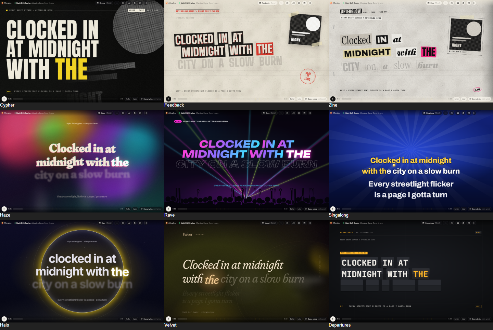

# Afterglow

**Full-screen, animated lyrics for whatever you're playing on Windows and Linux.** Play a song in Spotify and Afterglow puts every line on stage as it's sung, in one of 17 themes.



[**⬇ Download for Windows or Linux**](https://github.com/w4dux/afterglow/releases/latest) · [See it move (video)](docs/media/afterglow-motion-preview.mp4) · [Changelog](CHANGELOG.md)

## Why Afterglow

- **Install and go.** No account and no Spotify login. It follows whatever shows up in Windows' media controls, or in MPRIS on Linux.
- **In time with the music.** Words land when they're sung, and it stays in step when you pause, skip or seek.
- **A look for every song.** 17 themes, from a rap poster and a karaoke night to a lava lamp and a punk zine. Auto mode picks one from the song's genre.
- **Honest.** If the lyrics only have timing per line, Afterglow never pretends to know each word.
- **Light.** Smooth on a laptop, and it eases off on battery.

## Get started

1. Download from [Releases](https://github.com/w4dux/afterglow/releases/latest):
   - **Windows:** **Afterglow-Setup-2.6.0-x64.exe**, and run it. Windows may warn that the app isn't signed yet: choose **More info → Run anyway**.
   - **Linux (x64):** the **.AppImage** (`chmod +x` it, then run it), the **.deb** for Debian/Ubuntu (`sudo apt install ./afterglow_*.deb`), or the **.tar.gz**. Works with the Spotify desktop app (deb, Snap or Flatpak) and any other player that supports MPRIS. On Ubuntu 24.04 and newer the AppImage needs FUSE 2: `sudo apt install libfuse2t64` (or run it with `--appimage-extract-and-run`). The .deb doesn't need it.
2. Click **Follow Spotify**.
3. Play a song. That's it.

No Spotify handy? The built-in demo songs work offline.

| Key | Does |
|---|---|
| **Space** | Play / pause |
| **F** | Full screen |
| **T** | Pick a theme |
| **[ ]** | Lyrics a bit earlier / later |
| **?** | All shortcuts |

## Themes

Cypher · Nocturne · Velvet · Sherbet · Feedback · Horizon · Quiet · Afterhours · Riot · Prism · Halo · Monsoon · Departures · Haze · Rave · Singalong · Zine

Rap, trap, R&B, pop, rock, ambient, jazz, punk, house, melodic rap, Bangla ballads, new wave, psychedelic, party, karaoke and DIY punk each have a theme, plus a calm, minimal one for anything else.

## Where the lyrics come from

Afterglow sends only the song's title, artist, album and length to [LRCLIB](https://lrclib.net) (community lyrics), the [AMLL TTML database](https://github.com/amll-dev/amll-ttml-db) and Apple's public music catalogue (for the genre). Online lookup can be switched off, and you can paste lyrics or open your own `.lrc` files instead.

## Build it yourself

```bash
npm install
```

```bash
npm run dev
```

How it works, how it was measured and every build command: [docs/TECHNICAL.md](docs/TECHNICAL.md).

## Contributing

Found a bug, or want to design a theme? See [CONTRIBUTING.md](CONTRIBUTING.md). It includes a step-by-step "make your own theme" guide.

## License

[MIT](LICENSE)
