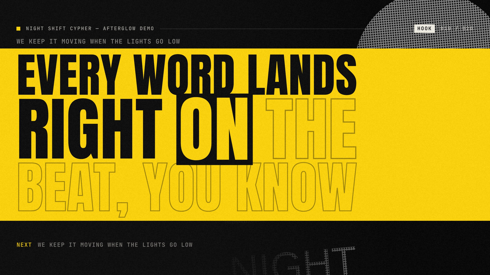

# Afterglow — full-screen kinetic lyrics for Windows

Afterglow turns your screen into a stage for the song you're playing. It follows Spotify (or any app in Windows' media controls), finds the lyrics, and shows each line as it is sung: the words being sung take the stage, arrive on time and hand over to the next phrase. Seventeen themes each have their own type, colour, background and motion, from a rap poster to a karaoke night to a cut-and-paste punk zine.



- **Install and go:** no account and no Spotify login. It reads what Windows already shows in its media controls.
- **Honest timing:** lyrics with word timing are shown word by word. Lyrics with line timing only are never dressed up as word timing; an optional estimate is clearly labelled "≈ estimated".
- **Picks a theme for the song** when the genre is known, or uses the one you choose.
- **Everything is a function of the song position**, so pausing, seeking and skipping stay in step.

Free and open source under the [MIT license](LICENSE).

**Motion preview (66 s, with the demo audio):** [`docs/media/afterglow-motion-preview.mp4`](docs/media/afterglow-motion-preview.mp4). It is rendered frame by frame from the real renderer at exact song positions.

---

## Run it

**Windows:** download the latest release from the [Releases page](https://github.com/w4dux/afterglow/releases).
- `Afterglow-Setup-2.6.0-x64.exe`: installer (per user; you can pick the folder).
- `Afterglow-2.6.0-win-x64.zip`: portable. Unzip, then run `Afterglow.exe`.

Neither is code-signed yet, so Windows SmartScreen warns on first launch: choose **More info → Run anyway**.

On first launch Afterglow offers to follow Spotify. Play a song there and the lyrics appear. Or try one of the built-in demo songs, which work offline. **Space** plays and pauses, **F** goes full screen, **T** opens the themes and **?** lists every shortcut.

**From source** (Node 22+):

```bash
npm install
```

```bash
npm run dev
```

`npm run dev` starts Vite plus Electron. The other scripts:

| Command | What it does |
|---|---|
| `npm test` | Unit tests (Vitest) |
| `npm run typecheck` | `tsc --noEmit` |
| `npm run build` | Renderer (Vite) + main/preload (esbuild) into `dist/` |
| `npm start` | Run the built app |
| `npm run e2e:controls` | Drives the built app with mouse and keyboard to check the controls hide and return |
| `npm run package:win` | Windows x64 installer + zip into `release/` |
| `npm run build:bridge` | Build the media bridge from `native/media-bridge` (Rust; a prebuilt copy is in `resources/bin`) |
| `npm run demo:assets` | Regenerate the demo songs (needs `espeak-ng`, `ffmpeg`) |
| `npm run e2e` | Electron end-to-end checks (bash; run under `xvfb-run` on Linux) |

---

## The experience

| Theme | For | Look and motion |
|---|---|---|
| **Cypher** | Rap / hip-hop | Poster-stacked rows that punch in on each word; unsung words wait as outlines; hooks get a signal-yellow block. |
| **Nocturne** | Trap / dark electronic | One line of chrome type in black space, a neon underline that snaps between words, a laser horizon. |
| **Velvet** | R&B / soul | A gliding column of serif italics; words warm from smoke to gold under a candle bloom. |
| **Sherbet** | Pop | Sticker cards on colour fields that wipe at every phrase; a bubble hops word to word. |
| **Feedback** | Rock / alternative | A photocopied gig poster: words stamped on black tape with a red misregistration; the sung word "boils". |
| **Horizon** | Ambient / acoustic | Cinematic negative space, one line low in frame, slow breathing light. |
| **Quiet** | Anything | Plain, calm and readable. Lowest CPU. |
| **Afterhours** | Lounge / jazz / slow soul | Golden serif type beside a turning record. |
| **Riot** | Punk / hardcore / metal | Acid-yellow ink, basement-show energy. |
| **Prism** | House / disco | Cobalt type and coral geometry. |
| **Halo** | Melodic rap | A ring of light; words come into focus as they're sung. |
| **Monsoon** | Bangla / desi ballads | Rain on the window; each word clears on the glass. Bengali shown with Nirmala UI. |
| **Departures** | New wave / city pop | A station board; every word flips in on its tile. |
| **Haze** | Psychedelic / stoner / reggae | Lava-lamp colour, floating soft 70s letters, lines that drift off like smoke. |
| **Rave** | Party / club / EDM | Lasers over a crowd of raised hands; choruses fire confetti. No strobe. |
| **Singalong** | Karaoke / musicals | Two rows, colour fill and a bouncing ball, only on real word timing. |
| **Zine** | Punk / DIY / garage | A cut-and-paste fanzine: every word a scrap in its own typeface, slapped down as it's sung. |

Keys **1–9** and **0** pick the first ten; all seventeen are in the theme library (**T**).

Screens: [Cypher verse](docs/media/01-cypher-verse.jpg) · [Nocturne](docs/media/03-nocturne.jpg) · [Velvet](docs/media/04-velvet.jpg) · [Sherbet](docs/media/05-sherbet.jpg) · [Feedback](docs/media/06-feedback.jpg) · [Horizon](docs/media/07-horizon.jpg) · [Quiet](docs/media/08-quiet.jpg) · [Haze](docs/design-2.5.0/haze.png) · [Rave](docs/design-2.5.0/rave.png) · [Singalong](docs/design-2.5.0/singalong-word-timing.png) · [Zine](docs/design-2.6.0/zine.png) · [Theme library](docs/design-2.6.0/theme-library.png)

**Stage behaviour shared by every theme**
- Current words dominate. The previous line is dim context, and the next line appears late and small. Context can be set to *Full*, *Minimal* or *Current only* (**C**).
- Rapid verses compress entrance timing (fast lines are detected from measured words per second). Long lines page or wrap into balanced rows. Short hooks are detected from repetition.
- **Instrumental sections** (gaps of 4.5 s or more), intros and outros get their own state with a countdown to the vocals. A line from before the break never reappears.
- Seeking lands on the correct phrase on the next frame. A line you seek into the middle of is shown settled, not replaying its entrance.
- The **controls recede** while playing (cursor hidden in full screen) and return on any mouse movement or key. Window controls use Electron's native window-controls overlay.
- Layout is computed from the stage size, so it adapts to resolution, Windows display scaling and small windows (tested down to 520×340). Text size is adjustable from 70 to 140%.

**Motion treatments** (Motion panel, **M**): *Signature* (the theme's own choreography), *Jiggle* (small word bounce and tilt), *Highlight* (active word only, no movement), *Still* (crossfades only). Intensity runs from 0 to 150%. *Reduced motion* follows the Windows setting or can be forced on; when active, nothing moves and only colour and opacity change. Effects that would strobe or shake the whole screen were deliberately left out.

**Beat pulse** runs only when the lyric source *states* a tempo and downbeat. The demos state them exactly, and an LRC file can via the `[bpm:]` and `[beat:]` tags. Otherwise the pulse is unavailable and the UI says why. Afterglow never estimates BPM.

---

## Matching a theme to the song

Auto mode decides **once per track** and then holds the decision for the rest of the song. Order of precedence:

1. **Your choice for this track** (any pick in the gallery is remembered for the track).
2. **Your choice for the artist** (optional "also use my pick for this artist").
3. **Known genre**, only when it is stated in metadata: file tags (ID3/Vorbis/MP4 via `music-metadata`), the Windows media session's `Genres` field, an LRC `[genre:]` tag, the demo manifest, or Apple's public music catalogue (looked up by title, artist and length, since Spotify does not tell Windows the genre). A keyword table maps genres to themes. The UI shows, for example, *"Known genre · Alternative (file tag)"*.
4. **Suggestion**, labelled as such: measured lyric pace from timed lyrics. A median of 3.0 words/s or more (with a p80 of 3.4 or more) suggests Cypher. A median of 1.1 words/s or less with 25% or more instrumental gaps suggests Horizon. It is shown as *"Suggested · fast lyric pace (3.6 words/s)"* and can be switched off.
5. **Your default theme** (Quiet unless you change it), shown as *"Default · no genre information"*.

**What actually works as a signal in this build:** your explicit picks, genre stated in metadata, and lyric pace computed from timestamps. **What it does not do:** audio analysis of genre, mood, energy or BPM. Spotify does not publish genres to Windows media sessions; since 2.3.0 Auto asks Apple's public catalogue instead, and falls back to a lyric-pace suggestion or your default when the song is not found. One click (or **1–9 / 0**) overrides it immediately, and that override is remembered.

---

## Synchronization

Timing is the highest priority, so here is exactly how it works and what was measured.

### Architecture

```
Playback adapter ──observations──▶ SyncEngine ──position(now)──▶ StageRuntime (one rAF loop)
  local audio: <audio>.currentTime           anchor + monotonic clock      lyric time = media − offset
  Windows GSMTC bridge (Rust, NDJSON)        slew / snap / reject          CueIndex → active line/word
                                                                           scene.frame(t) — pure function of t
```

- **Observations** say "at monotonic time *S* the player was at *P*, playing at rate *R*". The engine keeps an anchor and extrapolates with `performance.now()` between observations. Each observation is projected from its *own sample time*, so latency is accounted for.
- **Pause freezes immediately** with no extrapolation while paused. A pause that arrives with a stale timeline freezes at the current estimate instead of jumping back to an old timeline position.
- **Small drift** is absorbed with an exponentially decaying residual. τ ≥ 1.6×|error| keeps the displayed position monotonic, so it never moves backwards while playing. **Errors of 250 ms or more snap**, and seeks of 1.2 s or more (or explicit seek events) snap and are logged as seeks.
- **Rejected:** observations sampled before the last accepted one, out-of-order sequence numbers (per adapter *epoch*, so a restarted bridge is accepted), duplicates, and late observations for a previous track. Track changes bump a *generation*. Lyric lookups for an old track are discarded (`LatestRequest`).
- **Provisional observations**: when a player announces a new track before publishing its timeline, the adapter assumes "new track starts now". The next real observation always replaces this guess, even if it was sampled earlier, and the guess is never counted as a measurement.
- **Host resume** (sleep/lock): quality drops to *Estimating* until a fresh observation arrives, and the Windows bridge is asked to refresh.
- **Buffering** (`waiting`) and seeking are reported as not playing, so the engine never extrapolates through a stall.
- **Offsets:** a global output-latency offset (Bluetooth typically needs +150 to +300 ms) plus a per-track correction that is remembered (**[** / **]** 50 ms, Shift for 250 ms, **\\** to reset). *Tap to align* in the Timing panel sets the offset so a chosen line starts now. *Save lyrics with this offset applied* writes a corrected LRC.
- **Quality shown to the user:** *Locked* (local audio clock), *Tracking* (system player, recent or consistent updates), *Estimating* (extrapolating from an old or uncertain observation), *No timing* (the player publishes no position). The dot in the top bar and the Timing panel explain why.

**Word timing** is used only when the source has it: enhanced LRC `<mm:ss.xx>` word tags (including syllables), or TTML `<span begin end>`. With **line timestamps only**, lines are synced exactly, words arrive together with a short decorative stagger, and no word is ever highlighted as "sung". An optional **Estimated word sweep** exists. It is off by default and is marked *"≈ estimated word timing"* on screen while active. Since v2.0.1 it weights words by syllables, holds the final word longer, and sizes the sung part of each line from the song's own pace (80th-percentile syllables/second over its timed lines). It is still a heuristic and will sometimes be off.

### Measured results

| What | Result | Evidence |
|---|---|---|
| Chromium `<audio>.currentTime` granularity while playing | changes every frame; residual vs a linear fit: mean 0.08 ms, p95 0.16 ms | `docs/measurements/chromium-audio-clock.json` |
| **Displayed position vs the audio clock** (local/demo playback, 12 s, 718 frames) | **mean 0.82 ms, p95 2.7 ms, max 8.3 ms; never moved backwards** | same file |
| Pause | 0.000 ms drift after 1 s; displayed equals `currentTime` | same file |
| Seek | correct position and phrase on the **next frame** (16 ms) | same file |
| Track change | new track displayed on the next frame | same file |
| Simulated GSMTC-like source (unit test, *simulation*): updates every 250 ms, ±15 ms timestamp jitter, 40 ms delivery latency | mean 4.4 ms, p95 10 ms, max 14 ms. With 1 s updates: p95 13 ms. With clean timestamps: 0 ms | `tests/sync.test.ts` |
| Demo word timestamps | ground truth: the generator places each synthetic vocal word and writes the measured onset/offset | `scripts/generate-demo.mjs` |
| Render cost per frame, all 7 themes (Electron, 1600×900) | `scene.frame()` 0.03–0.12 ms average, p95 ≤ 0.2 ms; 60 fps | `docs/measurements/electron-perf-linux-xvfb.json` |
| While paused | render loop stops: 0 frames in 5 s, 0.2% CPU | same file |

The resource figures come from Linux under Xvfb, which has **no GPU** (software compositing). Total CPU while playing there ranged from 5% (Quiet) to 58% (Nocturne), and memory was about 0.7–0.8 GB across all Electron processes. Expect much lower CPU on a Windows machine with a GPU. That is not measured here.

**Not measured:** the acoustic latency of real speakers or headphones (headless Chromium uses a fake audio device). Chromium's `currentTime` already accounts for the output buffer it knows about; Bluetooth latency is what the global offset is for. Afterglow does not claim "perfect sync".

### Spotify through Windows media sessions (GSMTC)

`native/media-bridge` is a 405 KB Rust program that uses the documented WinRT API `Windows.Media.Control.GlobalSystemMediaTransportControlsSessionManager`. It prefers the Spotify session (any session is selectable), subscribes to `PlaybackInfoChanged`, `TimelinePropertiesChanged` and `MediaPropertiesChanged`, and re-reads the timeline once per second while playing to catch updates that arrive without an event. It streams NDJSON with `Position`, `LastUpdatedTime`, status, rate, controls, metadata, genres and artwork. It accepts play/pause/next/previous/seek commands, so Afterglow's transport controls Spotify when Spotify allows it.

The app converts each update with `sampledAt = performance.now() − (Date.now() − LastUpdatedTime)`. A timeline published minutes ago is therefore extrapolated from when it was valid, and pipe latency is included.

There are no Spotify credentials, cookies, tokens or private endpoints: Afterglow only sees what Spotify publishes to Windows' media overlay.

**Verified:** the bridge cross-compiles for Windows x64, and under Wine it starts, attempts WinRT activation, and reports `unavailable` cleanly (Wine does not implement GSMTC). On Linux the app shows *"System media is unavailable"*. Adapter, conversion, provisional-track logic and engine behaviour are unit-tested with simulated observations, which are labelled as simulation.

**Field test (Windows PC, Spotify from the Microsoft Store, v2.0.0):** the bridge connected to `SpotifyAB.SpotifyMusic…!Spotify`. Play/pause, next/previous and seeking from Afterglow controlled Spotify. LRCLIB lookups worked, and timing was reported as good. The diagnostics overlay showed:
- Spotify fired many timeline events, but the *position* changed about every 3.8 s while playing. Extrapolation between updates mostly needed only small slews.
- **At pause, Spotify reported a position 318–363 ms behind** the extrapolated one. The report it sent at **resume agreed with the frozen estimate within 22 ms**. Applying the pause report therefore made lyrics jump back about 0.3 s on every pause and forward again on resume. Since v2.0.1, for system players only, a paused report within 1.5 s of the pause that differs by 700 ms or less is held (logged as `hold`), and real seeks while paused still apply.

**Still not measured:** a full `--probe` run, which would show the exact update cadence, whether `LastUpdatedTime` is self-consistent, and how stale it is on arrival. To measure it on your machine:

```powershell
& "$env:LOCALAPPDATA\Programs\Afterglow\resources\bin\afterglow-media-bridge.exe" --probe 60
```

Adjust the path if you used the portable zip (`resources\bin\` next to `Afterglow.exe`). Play, pause, seek and skip in Spotify during the 60 s. The final `probe-summary` line reports update intervals, `LastUpdatedTime` self-consistency (position delta minus timestamp delta), and how stale timestamps are on arrival. The same numbers are live in the app's diagnostics (**D**). If Spotify publishes no timeline, the app says so and keeps the lyrics visible but unsynced.

---

## Lyrics: sources, formats, constraints

Resolution order per track (the first *synced* result wins, otherwise the first unsynced one; every source tried is listed in the UI):

1. A lyric file **you attached** to this track (import, drag and drop, or paste), remembered per track.
2. **Demo** lyrics (offline).
3. **Sidecar** file next to the audio: `song.elrc`, `song.lrc`, `song.ttml` or `song.txt`.
4. **Embedded tags**: ID3 `SYLT` (synced, millisecond timestamps), `USLT` / Vorbis lyrics (unsynced, or LRC-formatted).
5. A **lyrics folder** you choose: exact normalized matches of `Artist - Title.lrc`, or `Artist/Title.lrc`.
6. A **saved copy** of lyrics found online earlier for this track: instant, and works offline or when a provider is down. *Search again* bypasses it.
7. **Online sources** (opt-in), queried **in parallel**, each can be switched off:
   - **LRCLIB** (`lrclib.net`): large community database, mostly line timing. Lookups try the exact endpoint, then a cleaned title (feat./with, remaster, radio edit, "from …" removed; *Live*/*Remix* kept) with the primary artist, then field and free-text searches.
   - **AMLL TTML DB** (GitHub, CC0): community **word-timed** lyrics for about 3,400 songs, mostly Asian pop with some Western releases. The index is downloaded and matched on your PC, so only the chosen song's file is requested.

   Every candidate gets the same 0–100 score: title 40%, artist 35%, duration 20%, album 5%; a matching ISRC or Spotify ID counts as 100. Word timing is preferred when its score is within 8 points of the best line-timed result. When two sources disagree by more than 1.5 s, they are treated as different recordings, and the one whose duration matches better wins. Among three or more matching LRCLIB uploads, the one whose timings agree with the most others is chosen. Weak matches (score 55–69) are labelled *loose*, and duration differences come with a "timing may need an offset" note. A version you pick from *Other matches* is remembered for that track.

   [`docs/RESEARCH.md`](docs/RESEARCH.md) compares the sources other open-source lyric apps use and why the unofficial ones are not included.

**Formats:** LRC (all common timestamp precisions, multiple timestamps per line, `[offset:]`, blank and `♪` end markers), enhanced LRC (word and syllable tags), TTML (word spans, `x-bg` background vocals), plain text (unsynced, shown as a calm scrollable sheet with no fake highlighting). Afterglow extension tags: `[genre:]`, `[bpm:]`, `[beat:]`, `[meter:]`.

**Constraints, briefly:**
- LRCLIB is a free, community-contributed database with a documented public API and no key. Its availability does **not** grant lyric display or publishing rights. Afterglow shows LRCLIB lyrics with visible attribution, for personal use. A distributed or commercial product would need a licensed provider (e.g. Musixmatch or LyricFind), which requires a commercial agreement.
- Spotify's own lyrics are not available through any public API, and Afterglow does not imply access to them.
- The LRCLIB client was **not exercised live**: lrclib.net was blocked by the build environment's network policy. Its matching logic is unit-tested.

---

## Keyboard

Space/K play/pause · ←/→ ±5 s (Shift ±15 s) · , / . previous/next line · [ / ] lyrics earlier/later (Shift ×5) · \\ reset timing · F / F11 full screen · Esc close panel / leave full screen · T themes · 1–9 / 0 pick theme · M motion · C context · S music & lyrics · O open audio · L import lyrics · D diagnostics · ? help. Every control is keyboard-reachable with visible focus. Panels take focus when they open and return it when they close.

---

## Code map

```
electron/          main process: window, IPC, settings (atomic JSON), media protocol (range requests,
                   only user-opened files), metadata/embedded lyrics, lyrics folder, LRCLIB, bridge supervisor
native/media-bridge/  Rust GSMTC bridge (+ --probe measurement mode)
src/core/          pure, unit-tested logic
  sync/            SyncEngine, offsets
  lyrics/          model, LRC/eLRC, TTML, plain, cue index, analysis (hooks, pace), LRCLIB matching
  themes/          theme decision + genre table
  settings/        schema + validation
src/playback/      adapters: AudioElementAdapter (local/demo), SystemMediaAdapter (GSMTC)
src/lyrics/        resolution pipeline
src/stage/         runtime (single rAF loop), scene base, layout fitting, motion primitives, textures
src/themes/        the seventeen scenes (+ CSS); each theme owns its CSS class prefix
src/ui/            React chrome: transport, seek bar with lyric ticks, panels, diagnostics, status states
scripts/           demo generator, screenshots, motion-preview renderer, sync + perf measurement
tests/             Vitest unit tests; tests/e2e Electron end-to-end
```

Performance design: React never re-renders per frame. One `requestAnimationFrame` loop drives everything, and it stops when paused. Scenes write only transforms, opacity and changed attributes to about 30 visible word spans, using cached values. Text is measured once per line, not per frame. Artwork blur is baked once into a tiny image instead of a live CSS filter. No heavy dependencies at runtime: no animation library and no canvas engine.

## Validation done

- **Unit tests** (223 in 2.6.0): parsers, word boundaries, cue lookup (2,000 random seeks against brute force), pause/resume, forward/backward seeks, seek while paused, drift slewing (monotonic), snaps, stale/out-of-order/duplicate rejection, adapter restarts, track changes and stale old-track updates, provisional observations, playback end, future timestamps, no-timeline sources, host resume, offsets and tap-to-align, theme decisions, settings sanitization, lyric resolution order and missing lyrics, stale lyric responses, LRCLIB matching, multi-source scoring/cross-check/consensus, the lyrics cache, and a real AMLL TTML file, plus motion/layout invariants.
- **Electron end-to-end** (`tests/e2e/electron-smoke.mjs`): boot, demo playback "Locked", seek to the right line, pause freeze, theme override and offset **persist across restart**, local MP3 via the media protocol with sidecar LRC and genre tag → Feedback, embedded SYLT/USLT, missing lyrics → honest card + Quiet fallback, system media unavailable on non-Windows, reduced motion → zero word transforms.
- **Rendered UI** inspected at 1280×720, 1440×900, 640×400 and 520×340, for all themes plus gap, intro, line-only, estimated-sweep, no-lyrics and panel states.

## Remaining dependencies and unverified items

- **Spotify/GSMTC on Windows** is measured live (see `docs/AUDIT-2026-11-09.md`): Spotify reports songs 5.0 s short and its pause report lags about 300 ms; both are handled.
- **Windows:** tested on Windows 11 with Spotify; packages are built on Windows.
- **LRCLIB:** works live (field test). The v2.0.1 query variants are tested against mocked responses only.
- **AMLL TTML DB:** tested live from the build machine (index download, matching, file fetch, cache across restart).
- **Code signing:** none.
- **Audible latency** of real output devices is uncompensated beyond the manual and global offsets.
- **Demo vocals** are synthetic speech (espeak-ng) over procedurally generated music. Everything in the demo is original.


## 2.0.3 engine update (Windows)

This update fixes joining existing playback, stale updates after seeks, paused-position settling, and bridge reconnection. Recording keys preserve complete title/version, artist, album and source; broad theme preferences still use song keys. Existing ambiguous per-song lyric links/offsets from 2.0.2 are deliberately not copied to every recording: reattach/recalibrate them once if needed. Existing themes and motion preferences are preserved.

Online loading shows usable line timing while slower providers search. Cached line timing can refresh in the background. LRCLIB Lyricsfile 1.0 word timestamps are supported alongside enhanced LRC and AMLL TTML. Invalid word data falls back to line timing. Estimated word sweep remains optional and cannot promise vocal accuracy.

Development (PowerShell, Node.js and npm installed):

```powershell
npm ci
npm run typecheck
npm test
npm run build
npm start
```

Build Windows artifacts with `npm run package:win`. The supplied native helper is reused; Rust is only required to change/rebuild it. `node scripts/verify-windows.mjs` tests demo playback in an isolated profile. Add `--live` to temporarily control the current Windows player, test synchronization/recovery and restore its initial position/state. Set `AFTERGLOW_TEST_EXE` to test a packaged executable, and `AFTERGLOW_TEST_OUTPUT` to choose a results directory.

Fully extract the portable ZIP before running `Afterglow.exe`; keep its resources alongside it. The installer and portable app are unsigned. See `docs/ENGINE-PLAN.md` for validation and remaining limits. Apple Music and acoustic word alignment have not been certified.


## 2.1.0 theme collection

Three new displays: Afterhours (warm vinyl/serif listening room), Riot (acid-yellow punk poster), and Prism (cobalt/coral record-sleeve graphics). Cypher, Velvet and Feedback receive typography, light and print-detail refinements. The theme library prioritizes these six displays and shows live scene previews. Existing theme shortcuts 1-7 are preserved; 8 selects Afterhours, 9 Riot and 0 Prism.

New narrow genre mappings use stated metadata: lounge/smooth jazz/bossa nova -> Afterhours; hardcore/metalcore/industrial rock -> Riot; house/nu disco/future funk -> Prism. Existing rap, R&B, pop and rock defaults remain. All new motion follows lyric time, respects reduced motion and supports compact windows. Actual word timing and optional estimated effects retain their 2.0.3 semantics.

Run `node scripts/preview-themes.mjs` after building for real Electron screenshots and theme selection/layout checks in an isolated profile. Screenshots and results go to `docs/design-2.1.0`, or `AFTERGLOW_DESIGN_OUTPUT`. `AFTERGLOW_TEST_EXE` selects a packaged executable.


## 2.1.1 sync fixes (from the 2026-11-09 audit, `docs/AUDIT-2026-11-09.md`)

- **Song length from Spotify.** Measured on Windows: Spotify reports every song exactly 5.0 s short. This matches crossfade at 5 s. The short length made lyric matching prefer odd uploads, which were up to 1.8 s off, and drop real word timing.
  - System-player lengths are now treated as possibly short. Matching uses the length most uploads agree on, or a range until a per-player correction has been measured on several songs (`settings.learned.lengthOffsets`).
  - When several uploads exist, the most central timing wins.
  - Diagnostics (D) shows the `length` line.
- **Pause and resume.** Spotify's pause report lags about 300 ms. 2.0.3 applied it after 1.5 s, so lyrics jumped back and then forward on resume. The estimate is now held until resume, including when the lagging report arrives as a "playing" report just before the pause. Tested against two pause/resume traces captured on 2026-11-09.
- **Song changes.** A new song is not given the previous song's length when its title arrives before its timeline. The lyric search waits up to 1.5 s for the real length.
- **Line-timed lyrics.** A line before a long break ends after a generous estimate of its sung length, so the break shows as instrumental. The optional estimated sweep no longer stretches across breaks.
- **Saved lyrics.**
  - Reused for 7 days without going online; older copies are rechecked in the background.
  - A copy on screen is not swapped mid-song unless the new one adds real word timing.
  - Weak matches are not saved. Copies saved for a different song length are ignored.
  - "Nothing found" is remembered for 24 h ("Search again" bypasses it).
  - LRCLIB rate limits (HTTP 429) pause lookups instead of retrying.
  - Saved data moved from `userData/cache` (on Windows the same folder as Chromium's `Cache`) to `userData/library`. Existing files are moved on first start, and the folder is capped at 3,000 saved songs.
- **Version labels.** "Clean" or "Radio Edit" on only one side lowers a candidate's score instead of rejecting it. Live, remix, acoustic and similar labels still rule a candidate out.


## 2.2.0 first run, diagnostics, offset suggestion

- **Welcome (first run, Windows).**
  - One question with one primary button, **Follow Spotify**. It names the song currently playing, if any (one quick read of the Windows media session).
  - **Find lyrics online** is pre-ticked, with a one-line note on what is sent. "Try the demo first" is the alternative.
  - Shown once. People who already follow their player never see it.
- **Diagnostics report.**
  - **Copy diagnostics report** (Help panel, and the D overlay) copies a plain-text report to the clipboard: app version, current song, where its lyrics came from and why, song-length handling, timing quality and corrections, and the last log lines.
  - It contains no local paths or account data, and Afterglow sends it nowhere.
- **Log file.** `userData/logs/afterglow.log`, rolled over at 1 MB, with renderer lines rate-limited. It records start-up, the media connection, songs, lyric choices, timing-quality changes and errors. **Open log folder** opens it.
- **"Apply to all songs" suggestion.**
  - When at least 3 songs were corrected in the same direction by about the same amount (median ≥ 80 ms, ¾ within max(60 ms, 35 %)), the Timing panel offers to move that into the global offset. That is usually headphone or speaker delay.
  - Songs already corrected keep exactly their timing.
  - "Not now" is remembered until the evidence changes (3 more songs, or a different amount).


## 2.3.0 genre from Apple's catalogue, duets and translations, frame pacing

- **Genre from Apple's public iTunes catalogue.** Spotify publishes no genre to Windows. With online lookups on (switch: "Genre from Apple's catalogue"), Afterglow looks a new song up once by artist and title.
  - The match must be strong (same title and artist, plausible length; remixes and other artists are excluded). Results are saved for 30 days.
  - Apple's stated genre feeds the automatic theme as "Known genre · Hip-Hop/Rap (Apple catalogue)". Your own picks still come first.
  - If the song isn't in the results but at least 3 of the artist's own songs share one genre (≥ 75 %), that genre is used and labelled "this artist's songs".
  - The theme choice waits briefly for this lookup.
  - The same lookup gives the catalogue length from the same album. That is a second measure of the player's length gap: Orbiter 286.967 s at Apple vs 281.967 s from Spotify.
  - Artwork from Apple's image servers is used only when the player shows none.
- **Duets and translations (word-timed TTML).**
  - Singers named in the lyrics (`ttm:agent`) are numbered. Themes get `voice-1` / `voice-2` / `voice-group` classes, and the second singer is shown in italics.
  - Translations stated by the lyrics (inline `x-translation` spans or Apple-style head translations) appear as a caption under the stage; switch: "Show translations".
  - Romanizations are kept in the data. Nothing is machine-translated.
- **Frame pacing.** Lyric positions come from the clock, so frame rate changes smoothness only.
  - The display rate is measured. At 90 Hz and up, every 2nd frame (or more) is drawn, for about 60–72 fps.
  - With "Save battery" (on by default) and the PC on battery: about 30 fps, and no background blur.
  - 60 and 75 Hz displays still draw every frame when plugged in, because uneven skipping would stutter.
  - Diagnostics shows the measured rate.


## 2.4.0 new themes and plain-language controls

- **Three new themes** (see `docs/DESIGN-2.4.0.md`):
  - **Halo:** melodic rap; a ring of light, words coming into focus.
  - **Monsoon:** Bangla and rainy-night ballads; rain on the glass, words clearing, Bengali rendered with Nirmala UI.
  - **Departures:** a departure board; each word flips in on its tile.
  - New genre rules map stated genres to them. Keys 1–9/0 keep the original ten; the new themes are in the library (T).
- **Theme fixes:** Afterhours and Prism no longer run the artist label over the artwork. Velvet keeps the next line clear of tall lines.
- **Plain language:**
  - The top bar shows "Spotify · In sync"; the timing buttons read "Earlier" / "Later".
  - The Music & lyrics panel leads with "Follow Spotify", says where the lyrics came from in one sentence, and keeps technical switches under Advanced.
  - Status cards dim the stage and offer the next step: Search again, Paste lyrics, Open a lyrics file, or Try the demo.

## 2.6.0 Zine, controls that hide properly, polish

- **New theme, Zine** (punk · DIY · garage · riot grrrl; see `docs/DESIGN-2.6.0.md`): a cut-and-paste fanzine. Every word is a scrap in its own typeface and paper, slapped down as it's sung; upcoming words wait as pencilled cut-lines. The sung word is on fluoro pink, choruses on yellow highlighter, and the artwork is a cut-out-and-keep coupon. Plain "punk" stays with Feedback.
- **Controls auto-hide fixed.** They now hide when:
  - playback starts from Spotify itself, with no input in Afterglow;
  - you clicked a button (it kept focus);
  - a panel was closed with Esc.

  They stay up while paused, while a panel is open, while the pointer rests on them, and while you move through them with the keyboard. `npm run e2e:controls` checks all of this.
- **Polish:**
  - Top-bar buttons keep their size and stay clear of the window controls at every window width; the song title gives way first.
  - The Music & lyrics panel is spaced out, and the timing nudges sit on one row.
  - The theme library's NEW badge is readable on every card.
  - Feedback's intro stamp shrinks for long titles and stays clear of the artwork.
  - The welcome card points to "Music & lyrics".

## 2.5.0 Haze, Rave and Singalong

- **Three new themes** (see `docs/DESIGN-2.5.0.md`):
  - **Haze:** slow, hazy listening. Lava-lamp colour drifts behind soft, chunky 70s letters with double-vision trails; finished lines drift up like smoke.
  - **Rave:** a party. Laser fans over a crowd of raised hands; each sung word lifts the lights, and choruses fire confetti. No strobe or full-screen flashes.
  - **Singalong:** a karaoke screen. Two rows; with word timing each word fills as it is sung and a ball bounces on the words' own timestamps. With line timing the whole line fills at once and there is no ball.
  - Genre rules: psychedelic / stoner / reggae / dub / lo-fi hip hop / trip hop → Haze; party / club / big room / hardstyle / trance → Rave; karaoke / musicals / show tunes / schlager → Singalong.
- **Fixes:**
  - Lines on screen now re-fit when the window changes size (entering or leaving full screen). Before, seven themes could keep the old size until the next line.
  - Halo's dust motes no longer cost frames.
  - Each theme's stylesheet now owns its class names, and a test checks it (Haze's first draft clashed with Horizon's).
